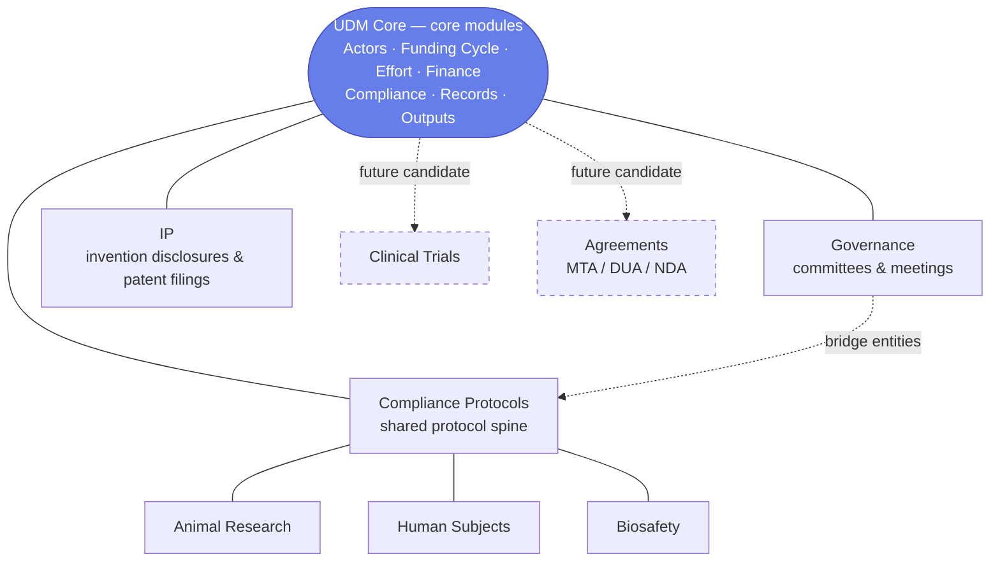

# AI4RA Unified Data Model (UDM)

A universal data model for research administration. The UDM provides a common schema that any institution can adopt to standardize how research administration data is structured, described, and shared — regardless of what systems they use internally.

**Current version: v2.3.0** (released 2026-08-28). Earlier versions are fixed commits under [GitHub Releases](https://github.com/ui-insight/AI4RA-UDM/releases); see [Versions](#versions).

## Mission

Research administration data is fragmented across institutions, locked in proprietary systems with inconsistent naming, structures, and definitions. The AI4RA UDM aims to:

- **Standardize** the language and structure of research administration data across institutions
- **Be generic enough** to accommodate the diverse needs of universities, research institutes, and funding agencies
- **Enable interoperability** between systems by providing a shared framework that institutions map their local data to
- **Support FAIR data principles** — making research administration data Findable, Accessible, Interoperable, and Reusable

The UDM is a **specification**, not a database. It defines what tables, columns, relationships, and constraints should exist. Institutions implement it in whatever database technology fits their environment and map their local data to the common model.

## How the UDM Is Defined

### Sources of Truth

The UDM v2 is defined in two complementary artifacts:

- [`vignettes/udm-v2-system-of-record.md`](vignettes/udm-v2-system-of-record.md) — the canonical prose specification: every entity, column, constraint, semantic convention, and design rationale, written database-engine agnostic.
- [`udm_schema.json`](udm_schema.json) — the machine-readable serialization of the spec, in an engine-neutral type vocabulary: tables, columns, types, foreign keys, allowed values, PII flags, column synonyms, cross-row constraints, derived-value rules, and example views. Use this to generate DDL, build crosswalk tooling, or feed schema context to LLMs.

The two are kept in exact sync; the prose spec is authoritative on intent, the JSON on machine-consumable detail. An architectural overview lives in [`vignettes/ontology.md`](vignettes/ontology.md), and the version history in [`vignettes/CHANGELOG.md`](vignettes/CHANGELOG.md).

The UDM is a normalized model, in the Inmon tradition: the standard defines the integrated System of Record, and star schemas are derived from it by each adopter as views ([why](vignettes/udm-v2-architecture.md#16-a-normalized-core-is-the-standard-star-schemas-are-the-adopters-choice)). Modules extend the standard and are conformance-checked; marts are deployment specific and are not part of it.

### Core Modules

The model's 47 tables are 45 in six core modules (the universal capabilities of research administration) plus two implementation tables:

| Core module | Tables | Purpose |
|--------|--------|---------|
| **Actors** | Personnel, PersonnelCredential, Organization, OrganizationCapability, OrganizationIdentifier, OrganizationRole, ContactDetails | People, organizations, their roles, credentials, and contact information |
| **Funding Cycle** | RFA, RFARequirement, Proposal, ProposalApproval, PreAwardAuthorization, Award, Modification, Subaward, Negotiation, Terms, Report, Closeout | The full lifecycle from funding opportunity through proposal, award, and closeout |
| **Effort** | AwardRole, Effort | Roles on funded work and effort certification |
| **Finance** | Budget, Fund, Account, FinanceCode, Transaction, RateAgreement, IndirectRate, Payment, CostShare, Equipment | Budgets, accounting, transactions, rates, and capital assets |
| **Compliance** | ComplianceRequirement, ComplianceCoverage, ProtocolRole, ConflictOfInterest, OtherSupport, OtherSupportDisclosure, PolicyException | IRB/IACUC protocols, COI, other support, policy exceptions, and regulatory tracking |
| **Records** | Document, Communication, Restriction, Deadline, Classification, Action, CommunicationResponse | The records that accumulate around the work, attached across all core modules |

**Implementation tables** (not a core module): `AllowedValues` (institution-specific controlled vocabularies with cross-institution canonical codes) and `BudgetCategory` (shared budget category reference). Core modules are research-administration capabilities; these two tables support the model's mechanics.

The model also includes **12 example views** (e.g., `vw_Active_Awards`, `vw_Award_Lineage`, `vw_Overdue_Reports`) as reference query implementations that institutions can adopt or adapt for dashboards and reporting. They are written against the MySQL dialect mapping; each carries a `dialect` field, and date functions need adapting for other engines.

Browse the full model interactively at the [UDM Dashboard](https://ui-insight.github.io/AI4RA-UDM/).

### Naming Conventions (Ontology)

The UDM follows consistent, predictable naming patterns:

- **Tables**: PascalCase, singular — `AwardRole`, `ComplianceCoverage`, `Personnel`
- **Columns**: Snake_Case — `Award_Number`, `Start_Date`, `Is_Active`
- **Primary keys**: `TableName_ID` — `Personnel_ID`, `Award_ID`, `Organization_ID` (one deliberate exception: `AllowedValues` uses the singular `AllowedValue_ID`)
- **Foreign keys**: Named by role, not generically — `Sponsor_Organization_ID`, `Administering_Organization_ID`, `Subrecipient_Organization_ID` (not just `Organization_ID`)
- **Standard suffixes**: `_ID`, `_Date`, `_Status`, `_Type`, `_Amount`, `_Percent`, `_Number`, `_Name`, `_Description`
- **Booleans**: Prefixed with `Is_` (`Is_Active`, `Is_Flow_Through`) or a similarly interrogative form (`Subject_To_Federal_Funding`, `Requires_Prior_Approval`)

For full ontology documentation, see [`vignettes/ontology.md`](vignettes/ontology.md).

### Design Patterns

v2 rests on a small set of universal patterns applied consistently across the model:

- **Lifecycle_Stage discriminator** — one table carries a record through its whole life (Budget: Proposed → Approved → Current → Actual; likewise Effort, CostShare, Payment), with revisions chained through `Previous_*_ID`.
- **Two-FK exclusive-or attachment** — satellite tables (Modification, Report, Transaction, Terms, Closeout, and others) attach to either an Award or a Subaward via two nullable FKs, keeping inbound and outbound funding symmetric.
- **Polymorphic attachment** — six Records tables reference any permitted entity via `Related_Entity_Type` + `Related_Entity_ID`, with documented minimum-conformance enforcement behavior.
- **Flexible vs. fixed enumerations** — institution-specific vocabularies live in the `AllowedValues` table (with `Canonical_Value_Code` for cross-institution normalization); universal standards use CHECK constraints. See [allowedvalues.md](vignettes/allowedvalues.md).
- **Derived columns with recompute triggers** — convenience columns like `Award.Current_End_Date` are documented as derived, with the rules to recompute them.
- **Audit and provenance columns** on every table (`Created_At`, `Updated_At`, `Source_System`, `Source_Record_ID`, `Is_Active`).

For a detailed explanation of every table, pattern, and design decision, see the [prose specification](vignettes/udm-v2-system-of-record.md).

### JSON Format

The `udm_schema.json` structure (abbreviated). Everything specified is a module, and a rule lives on the thing it governs: constraints on their table, derivation rules and synonyms on their column, conventions and example views on their module.

```json
{
  "metadata": { "name": "UDM", "version": "2.3.0", "spec_source": "vignettes/udm-v2-system-of-record.md" },
  "types": { "abstract": ["ID", "Money", "..."], "dialects": { "mysql": { "ID": "VARCHAR(50)", "Money": "DECIMAL(18,2)", "...": "..." }, "postgresql": { "...": "..." } } },
  "conventions": { "identifier": {}, "hierarchy": {}, "polymorphic_attachment": {}, "lifecycle_stage": {}, "audit_columns": {}, "constraint_vocabulary": {}, "semantic": [], "...": {} },
  "modules": {
    "laws": { "capability_criterion": "...", "encapsulation_rule": "..." },
    "core": {
      "funding_cycle": {
        "name": "Funding Cycle",
        "story": "We pursue and manage funded agreements, opportunity through closeout",
        "tables": {
          "Award": {
            "description": "Funded agreements...",
            "columns": {
              "Award_ID": { "type": "ID", "primary_key": true, "required": true, "description": "PK" },
              "Sponsor_Organization_ID": { "type": "ID", "references": { "table": "Organization", "column": "Organization_ID" }, "description": "..." },
              "Award_Status": { "type": "Status", "allowed_values": ["Pending", "Active", "Closing", "Closed", "Suspended", "Terminated"], "synonyms": "Grant Status, Status", "description": "..." },
              "Current_End_Date": { "type": "DATE", "derived": { "rule": "...", "recompute_triggers": "..." }, "description": "..." }
            },
            "constraints": [ { "rule": "...", "structured": { "type": "referenced_status_is", "...": "..." } } ]
          }
        },
        "conventions": [ { "name": "Modification vs Parent_Award_ID vs Previous_Award_ID", "...": "..." } ],
        "example_views": [ { "name": "vw_Active_Awards", "purpose": "...", "sql": "SELECT ..." } ]
      }
    },
    "optional": { "governance": { "name": "Governance", "story": "...", "requires": { "core": ">=2.3.0", "modules": [] }, "tables": {} } }
  },
  "implementation_tables": { "tables": { "AllowedValues": {}, "BudgetCategory": {} } }
}
```

## Accessing the UDM

The UDM is served as static JSON via GitHub Pages. These endpoints define the **framework** — the structure and conventions of the data model. They do not contain populated data; institutions implement the model and populate it with their own data.

| Endpoint | Description |
|----------|-------------|
| [`/data/udm_schema.json`](https://ui-insight.github.io/AI4RA-UDM/data/udm_schema.json) | **Complete v2 schema (current)** — tables, columns, types, constraints, descriptions, synonyms, PII flags, cross-row constraints, example views |
| [`/data/data-dictionary.json`](https://ui-insight.github.io/AI4RA-UDM/data/data-dictionary.json) | Human-readable descriptions, synonyms, and PII flags |
| [`/data/relationships.json`](https://ui-insight.github.io/AI4RA-UDM/data/relationships.json) | Foreign key relationships |

Most consumers only need the primary endpoint (`udm_schema.json`) — it contains everything.

```javascript
// Fetch the full UDM v2 schema
const response = await fetch('https://ui-insight.github.io/AI4RA-UDM/data/udm_schema.json');
const udm = await response.json();

// Every table lives in its module: core modules, optional modules, or the implementation tables
const coreTables = Object.assign({}, ...Object.values(udm.modules.core).map(m => m.tables));
Object.keys(coreTables);  // ["Personnel", "Organization", "RFA", "Proposal", "Award", ...]

// A table's columns, each with type, description, synonyms, and any derivation rule
coreTables.Award.columns;

// Every foreign key relationship in the core
for (const [table, data] of Object.entries(coreTables)) {
  for (const [col, def] of Object.entries(data.columns)) {
    if (def.references) {
      console.log(`${table}.${col} → ${def.references.table}.${def.references.column}`);
    }
  }
}
```

## Implementing the UDM

The UDM names no database engine. Column types are an abstract vocabulary (`ID`, `Money`, `Date`, `Status`, ...), and the JSON carries one mapping per engine under `types.dialects`. To get a schema for your platform:

```
python scripts/generate_ddl.py --dialect postgresql                      # core only
python scripts/generate_ddl.py --dialect mysql --modules governance      # core plus a module
python scripts/generate_ddl.py --list-dialects
python scripts/generate_seed.py --dialect postgresql                     # reference rows: vocabularies and budget categories
```

The DDL generator emits tables, columns, primary and foreign keys, and CHECK constraints for closed vocabularies. The seed generator emits the rows a new database needs before anything else works: one AllowedValues row per recommended code in each value group, and the SF-424 R&R budget categories. Reference data, not sample data; institutions add their own codes beside it. It does not emit the cross-row constraints, derivation rules, or polymorphic attachment enforcement; the specification states those rules and leaves the mechanism (triggers, application code, scheduled checks) to you. Adding an engine is one mapping of the abstract types, contributed under `types.dialects`. The site serves generated DDL and seed files for every mapped dialect under `/ddl/`.

| Technology | Notes |
|------------|-------|
| **Relational engines** | Generate DDL with the script, or map the abstract types yourself |
| **MongoDB / NoSQL** | Use the JSON directly as collection definitions; embed related documents where appropriate instead of FK joins |
| **Data Warehouse (Snowflake, BigQuery, Redshift)** | Use as a staging/canonical layer; map the abstract types to platform variants |

Institutions are expected to:
1. **Map** their local field names to UDM column names (every column carries a `description` and a `synonyms` list of common alternate names, to help matchers identify equivalent concepts)
2. **Populate** the AllowedValues table with their institution-specific lookup values, including `Canonical_Value_Code` mappings for cross-institution comparability
3. **Adapt** the example views to their reporting needs

### Crosswalks

A **crosswalk** is a declarative mapping between a source system's vocabulary and the UDM's — one row per source field, listing the target UDM column, any value-translation rules, and transformation notes. Crosswalks are the concrete artifact that operationalizes step 1 above.

| Source Column | UDM Column | Value Translation |
|---------------|------------|-------------------|
| `grantNumber` | `Award.Award_Number` | direct |
| `pi_email` | `ContactDetails.Contact_Value` (with `Contact_Type = "Email"`) | pivot |
| `STATUS_CD = 'A'` | `Award.Award_Status = 'Active'` | enum lookup |
| `proj_start` (MM/DD/YYYY) | `Proposal.Proposed_Start_Date` | parse to DATE |

The UDM supports crosswalk authoring in two places:

- **`synonyms`** on each column — common alternate names, so matchers can identify equivalent concepts without a hand-built dictionary.
- **`description`** on every table and column — plain-language purpose that ML or LLM matchers can use alongside the column name to disambiguate near-duplicates.

In a medallion lakehouse, the crosswalk *is* the Silver layer: each source gets its own Silver schema that renames/pivots/coerces its raw Bronze data into UDM-shaped columns. The Gold layer then unions the Silver views across sources.

See the [Infrastructure tab](https://ui-insight.github.io/AI4RA-UDM/) of the dashboard for diagrams of both the Silver crosswalk layer and the surrounding medallion architecture.

### Conformance

An implementation or a vendor product shows that it follows the UDM with a conformance declaration that passes [`scripts/check_conformance.py`](scripts/check_conformance.py). There are two profiles: **implementation**, for a System of Record carrying the core plus its declared modules, and **provider**, for a source system that delivers a subset of tables in UDM form. See [Conformance](vignettes/udm-v2-conformance.md) for the rules, and [Procurement Language](vignettes/udm-v2-procurement-language.md) for model contract clauses an institution can use to ask vendors for it.

## Versions

The repository carries one version of the schema, the current one. Its version is in the `metadata` block of [`udm_schema.json`](udm_schema.json) and in the prose spec. Every release is a fixed commit published under [GitHub Releases](https://github.com/ui-insight/AI4RA-UDM/releases); an earlier version is read or cited from its release.

v2 is a major refactor: 47 tables (from 40), six core modules (from ten domains), unified lifecycle modeling, Award/Subaward symmetry, and rule catalogs for cross-row constraints and semantic conventions. See the [CHANGELOG](vignettes/CHANGELOG.md) for the full delta and migration guidance from v1.

## Roadmap: Core and Optional Modules

The UDM grows by a hub-and-spoke plan under one taxonomy: everything specified is a **module**. **Core modules** are the universal capabilities, required of every implementation; **optional modules** are declared per implementation ("UDM core + modules: governance, IP"); **local extensions** are unspecified. Two laws govern every module. The **capability criterion**: a module must be a capability an institution recognizably exercises ("we do X"), with universality deciding the tier; modules are carved by story, never by abstraction depth. The **encapsulation rule**: a module adds only its own tables, referencing the core by foreign key; it never adds columns to, alters constraints of, or extends the closed vocabularies of the core, with two sanctioned extension points (the Records target registry and AllowedValues value groups).



| Piece | Contents | Status |
|---|---|---|
| **Outputs (core module 7)** | Output, OutputContributor, AwardOutput, PublicationDetail, DatasetDetail, SoftwareDetail — what funded work produced, reported against awards | Designed ([#71](https://github.com/ui-insight/AI4RA-UDM/issues/71)) |
| **IP module** | InventionDisclosureDetail, PatentFiling — disclosure events, Bayh-Dole election, filing records | Designed |
| **Governance module** | Committee, CommitteeMember, Meeting, MeetingAttendance, plus the Committee Protocol Review bridge | **Released v2.3** ([spec](vignettes/modules/governance.md)) |
| **Compliance Protocols (shared spine)** | Protocol, coverage, personnel, review workflow, amendments, continuing review, adverse events, deviations | **Released v2.3** ([spec](vignettes/modules/compliance-protocols.md)) |
| **Animal Research / Human Subjects / Biosafety modules** | Per-regime protocol detail on the spine | **Released v2.3** ([specs](vignettes/modules/)) |
| **Clinical Trials, Agreements** | Registration/enrollment records; MTA / DUA / NDA lifecycles | Future candidates |

## Contributing

The UDM improves through community input: open a [GitHub Issue](https://github.com/ui-insight/AI4RA-UDM/issues) to suggest a change, use [GitHub Discussions](https://github.com/ui-insight/AI4RA-UDM/discussions) for broader questions, or take the short [practitioner survey](https://bit.ly/4b5b21q). See [CONTRIBUTING.md](CONTRIBUTING.md) for how to make a change and the license terms that apply to contributions.

<!-- ERD_START -->
## Entity Relationship Diagram

```mermaid
graph TD

    Action-->AllowedValues
    Action-->Document
    Action-->Personnel
    Award-->AllowedValues
    Award-->Award
    Award-->Organization
    Award-->Personnel
    Award-->Proposal
    Award-->RFA
    AwardRole-->AllowedValues
    AwardRole-->Award
    AwardRole-->Organization
    AwardRole-->Personnel
    AwardRole-->Subaward
    Budget-->Award
    Budget-->Budget
    Budget-->BudgetCategory
    Budget-->IndirectRate
    Budget-->Proposal
    Budget-->Subaward
    Closeout-->Award
    Closeout-->Subaward
    Communication-->Organization
    Communication-->Personnel
    CommunicationResponse-->AllowedValues
    CommunicationResponse-->Communication
    CommunicationResponse-->Personnel
    ComplianceCoverage-->Award
    ComplianceCoverage-->ComplianceRequirement
    ComplianceCoverage-->Subaward
    ComplianceRequirement-->AllowedValues
    ComplianceRequirement-->ComplianceRequirement
    ComplianceRequirement-->Organization
    ConflictOfInterest-->AllowedValues
    ConflictOfInterest-->Award
    ConflictOfInterest-->Organization
    ConflictOfInterest-->OtherSupport
    ConflictOfInterest-->Personnel
    ContactDetails-->AllowedValues
    ContactDetails-->Organization
    ContactDetails-->Personnel
    CostShare-->AllowedValues
    CostShare-->Award
    CostShare-->CostShare
    CostShare-->Proposal
    CostShare-->Subaward
    Deadline-->AllowedValues
    Deadline-->Personnel
    Document-->AllowedValues
    Document-->Document
    Document-->Personnel
    Effort-->AwardRole
    Effort-->Effort
    Effort-->Personnel
    Equipment-->Award
    Equipment-->Organization
    Equipment-->Personnel
    Equipment-->Subaward
    FinanceCode-->Account
    FinanceCode-->AllowedValues
    FinanceCode-->Award
    FinanceCode-->Fund
    Fund-->AllowedValues
    Fund-->Organization
    IndirectRate-->RateAgreement
    Modification-->AllowedValues
    Modification-->Award
    Modification-->Subaward
    Negotiation-->Award
    Negotiation-->Organization
    Negotiation-->Personnel
    Negotiation-->Proposal
    Negotiation-->Subaward
    Organization-->Organization
    OrganizationCapability-->AllowedValues
    OrganizationCapability-->Organization
    OrganizationIdentifier-->Organization
    OrganizationRole-->AllowedValues
    OrganizationRole-->Award
    OrganizationRole-->Organization
    OrganizationRole-->Personnel
    OrganizationRole-->RFA
    OrganizationRole-->Subaward
    OtherSupport-->Organization
    OtherSupport-->Personnel
    OtherSupportDisclosure-->Award
    OtherSupportDisclosure-->Organization
    OtherSupportDisclosure-->OtherSupport
    OtherSupportDisclosure-->Proposal
    Payment-->Award
    Payment-->Budget
    Payment-->Payment
    Payment-->Subaward
    Personnel-->Organization
    PersonnelCredential-->Organization
    PersonnelCredential-->Personnel
    PolicyException-->Award
    PolicyException-->Personnel
    PolicyException-->Proposal
    PolicyException-->Subaward
    PreAwardAuthorization-->Award
    PreAwardAuthorization-->Personnel
    PreAwardAuthorization-->Proposal
    Proposal-->AllowedValues
    Proposal-->Organization
    Proposal-->Proposal
    Proposal-->RFA
    ProposalApproval-->Personnel
    ProposalApproval-->Proposal
    ProtocolRole-->AllowedValues
    ProtocolRole-->Award
    ProtocolRole-->ComplianceRequirement
    ProtocolRole-->Personnel
    ProtocolRole-->Subaward
    RFA-->AllowedValues
    RFA-->Organization
    RFARequirement-->RFA
    RateAgreement-->Organization
    Report-->Award
    Report-->Document
    Report-->Personnel
    Report-->Subaward
    Restriction-->AllowedValues
    Restriction-->Personnel
    Subaward-->Award
    Subaward-->Organization
    Subaward-->Personnel
    Subaward-->Proposal
    Subaward-->Subaward
    Terms-->Award
    Terms-->Subaward
    Transaction-->Account
    Transaction-->AllowedValues
    Transaction-->Award
    Transaction-->Budget
    Transaction-->CostShare
    Transaction-->FinanceCode
    Transaction-->Fund
    Transaction-->Subaward
```


<!-- ERD_END -->

## License

Copyright 2025 Nathan Layman.

The AI4RA Unified Data Model is licensed in two parts:

- **The standard** (the schema, naming conventions and documentation) is licensed under [CC BY 4.0](LICENSE-CC-BY-4.0). Anyone, vendors included, can use it and build it into a product, with attribution required.
- **The code** (the scripts, the dashboard and the build workflows) is licensed under [Apache-2.0](LICENSE-APACHE-2.0).

The machine-readable schema files are available under either license, at your option. [NOTICE](NOTICE) lists which files fall under which license. It is the attribution notice under Apache-2.0 Section 4(d) and carries the attribution CC BY 4.0 requires: any redistribution of the work or a derivative must credit Nathan Layman as author, AI4RA, the University of Idaho, and NSF award 2427549. To cite the project, use [CITATION.cff](CITATION.cff).

The names "AI4RA Unified Data Model" and "AI4RA UDM" are reserved for conforming versions. See [NAME-POLICY.md](NAME-POLICY.md).

## Acknowledgments

The AI4RA Unified Data Model is a project of [AI4RA](https://ai4ra.uidaho.edu/) (AI for Research Administration) at the University of Idaho.

This material is based upon work supported by the U.S. National Science Foundation under the GRANTED program, [award number 2427549](https://www.nsf.gov/awardsearch/showAward?AWD_ID=2427549), "Crossing the Innovation Valley of Death: Democratizing Data and Artificial Intelligence for Research Administration". Any opinions, findings, and conclusions or recommendations expressed in this material are those of the author and do not necessarily reflect the views of the National Science Foundation.
